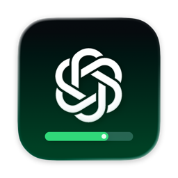
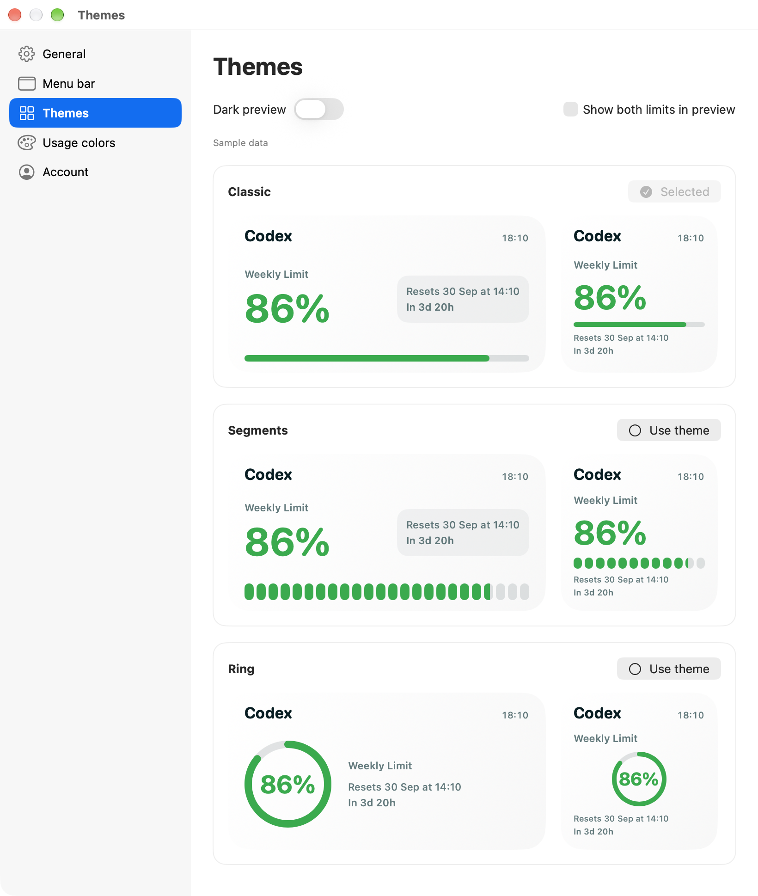

<p align="center">
  
</p>
<h1 align="center">CodexLimits</h1>
<p align="center">Your remaining ChatGPT Codex usage, at a glance.<br>A native macOS menu bar app with desktop widgets.</p>

<p align="center">
  <a href="https://github.com/Anywhere-Music-Player/CodexLimits/releases/latest"></a>
  
  
  <a href="LICENSE"></a>
</p>
<p align="center">
  <a href="#quick-start">Build &amp; install</a> ·
  <a href="#development">Development</a> ·
  <a href="https://github.com/Anywhere-Music-Player/CodexLimits/releases">Releases</a> ·
  <a href="https://github.com/Anywhere-Music-Player/CodexLimits/issues">Report an issue</a>
</p>

## At a glance

| Feature | What you get |
| --- | --- |
| Menu bar | Remaining percentages, compact progress meters, or both, with an immediate settings preview. |
| Adaptive limits | Shows the available 5-hour and weekly limits; weekly-only accounts have no empty 5-hour placeholder. |
| Desktop widgets | Small and medium widgets in Classic, Segments, and Ring themes. |
| Reset tracking | Reset dates and localized countdowns, without a redundant remaining label. |
| Available resets | Available usage limit resets with compact local expiration dates at the top of the menu and full dates in General settings. |
| Personalization | Usage colors and sidebar settings with theme previews in both sizes and appearances. |
| Refresh | Choose an interval of 1, 2, 3, or 5 minutes. |
| Sign-in | Authenticate through an embedded ChatGPT web view. |

## Settings & widget themes

<p align="center">
  
</p>
<p align="center"><sub>Theme previews use sample data. Actual limits depend on your account.</sub></p>

## Quick start

Download the source archive from the [latest release](https://github.com/Anywhere-Music-Player/CodexLimits/releases/latest), or clone the repository below. Releases currently provide source code; build the app with Xcode on macOS:

```sh
git clone https://github.com/Anywhere-Music-Player/CodexLimits.git
cd CodexLimits
open CodexLimits.xcodeproj
```

1. Select your Apple Developer team for the app and widget targets.
2. Register and enable the App Group `group.com.buildsucceeded.codex-limits` for both targets.
3. Select the **CodexLimits** scheme and your Mac as the destination, then build and run.
4. Open **Settings → Account** from the menu bar and choose **Sign in with browser**.
5. Choose your refresh interval and menu bar display. To use a widget, open macOS **Edit Widgets**, find **CodexLimits**, and add a small or medium widget.

For example, enable percentages and progress meters to keep remaining usage visible while you work, then choose a widget theme under **Settings → Themes**.

Once signing is configured, install and test the current checkout without opening Xcode:

```sh
Scripts/install-local.sh
```

The script builds and signs both targets, verifies the bundle, quits the running CodexLimits app, backs up the previous `/Applications/CodexLimits.app` under `~/Library/Application Support/CodexLimits/LocalBuildBackups`, installs the new build, and opens Settings. It restores the previous app if launch verification fails. It requires write access to `/Applications` and access to your configured development signing certificate.

The targets use Xcode's recommended macOS deployment target. Check the resolved deployment target in Xcode for the version you are building.

## Development

| Directory | Purpose |
| --- | --- |
| `CodexLimits/` | App entry point, menu bar, settings, browser login, and usage fetcher. |
| `CodexLimitsShared/` | Shared models, snapshot storage, refresh settings, and widget presentation. |
| `CodexLimitsWidget/` | WidgetKit extension. |
| `Tests/` | Presentation and usage-model checks. |

### Data flow

The app uses the official Codex app-server over local stdio. **Sign in with browser** opens the OpenAI authorization page in your default browser, where you can use Apple or another supported sign-in method. The app-server handles the local OAuth callback, credential persistence, token refresh, and `account/rateLimits/read`. CodexLimits does not start agent turns or inference requests.

This integration requires an installed ChatGPT desktop app or Codex CLI. It discovers the ChatGPT-bundled executable, the older Codex app executable, or Codex CLI in `/opt/homebrew/bin` or `/usr/local/bin`. No runtime is downloaded automatically. The current integration was developed against `codex-cli 0.162.0-alpha.17.2`; other versions need compatibility verification before distribution. Packaging a pinned runtime remains a release decision.

Authentication is isolated in `CodexLimits/BrowserAuth` under the app's sandbox Application Support directory, using a dedicated `CODEX_HOME`. Codex manages its `auth.json`; the directory is private (0700), and the credential file is restricted to 0600 after login. Never share this file. Signing in here does not replace the ChatGPT desktop app's or CLI's existing account. The app needs outgoing network access and an incoming-network entitlement for the local login callback.

Only the usage snapshot and status are shared with WidgetKit. The app saves `usage_snapshot.json` in the App Group container; the menu bar uses live app state. A successful new login clears cached usage before fetching the selected account's limits.

Protocol reference: [Codex App Server](https://learn.chatgpt.com/docs/app-server). Authentication reference: [Codex authentication](https://learn.chatgpt.com/docs/auth).

Run `Scripts/check-browser-auth.sh` for offline RPC, persistence, cancellation, timeout, URL-validation, and usage-mapping checks. `Scripts/try-browser-login.sh` runs an interactive sandboxed smoke test: complete sign-in in your browser, then it checks usage and restarts the service to check persistence. This probe uses its own sandbox container; it does not sign the production app in or alter its stored snapshot. No passwords or tokens are printed.

Available usage limit resets come from `https://chatgpt.com/backend-api/wham/rate-limit-reset-credits` using the same account-scoped session. Expiration dates follow the system locale and local time zone, including daylight saving changes. General settings and menu tooltips show the full timestamp; menu rows use a compact date and time. Missing reset details are marked as unavailable, and known expired resets are excluded from the available count.

The widget provides minute-spaced countdown entries for one hour between timeline reloads. WidgetKit controls actual delivery and may defer updates.

### Presentation checks

Run the checks on macOS with Xcode installed:

```sh
Scripts/check-presentation.sh
```

They cover account-scoped authentication, weekly-only parsing, menu-bar display modes, available reset counts and expiration dates, local time and daylight saving changes, snapshot compatibility, and saved themes.

To also render native settings and widget states without opening the app or starting account requests:

```sh
CODEX_LIMITS_RENDER_DIR=/tmp/codexlimits-previews Scripts/check-presentation.sh
```

## Contributing

Bug reports and focused pull requests are welcome. Include your macOS and Xcode versions, reproduction steps, and screenshots where helpful in an [issue](https://github.com/Anywhere-Music-Player/CodexLimits/issues).

Read [the contributor notes](AGENTS.md) before making changes. Keep the app Codex-only, preserve the supported localizations, add new UI strings to every supported localization, and keep refresh choices limited to 1, 2, 3, and 5 minutes. Source code and documentation are maintained in English.

## License

CodexLimits is available under the [MIT License](LICENSE).

### Launch at login

**General → Launch at login** controls the native macOS login item through ServiceManagement. It is enabled on the first launch of this version; later changes in the app or System Settings are respected. If macOS requires approval, General provides a shortcut to Login Items. Registration errors are shown beside the setting.

Run `Scripts/check-launch-at-login.sh` to verify the default, opt-out, approval, and error-handling behavior without changing system login items.
